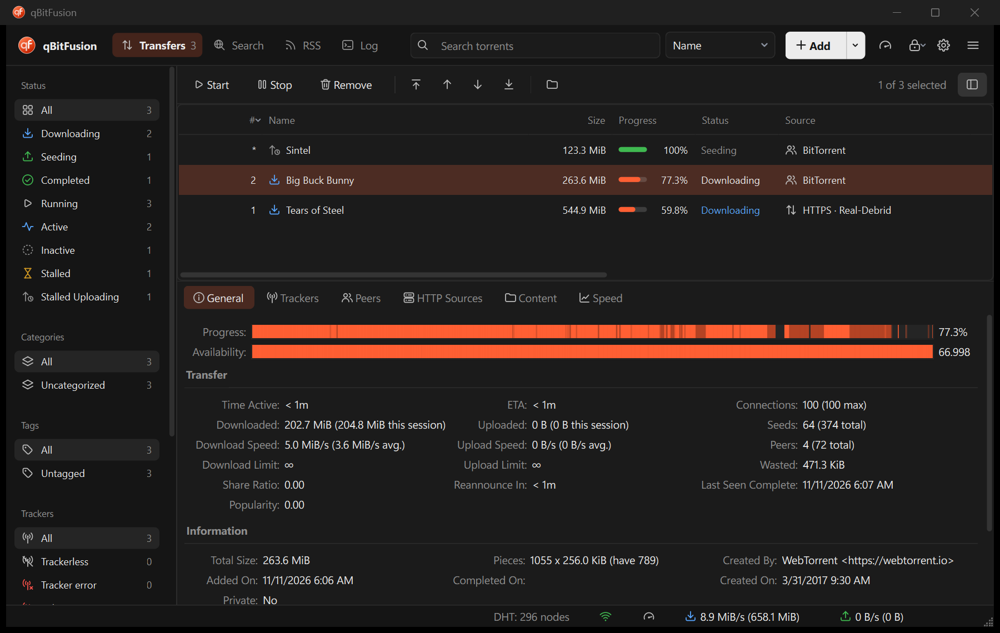
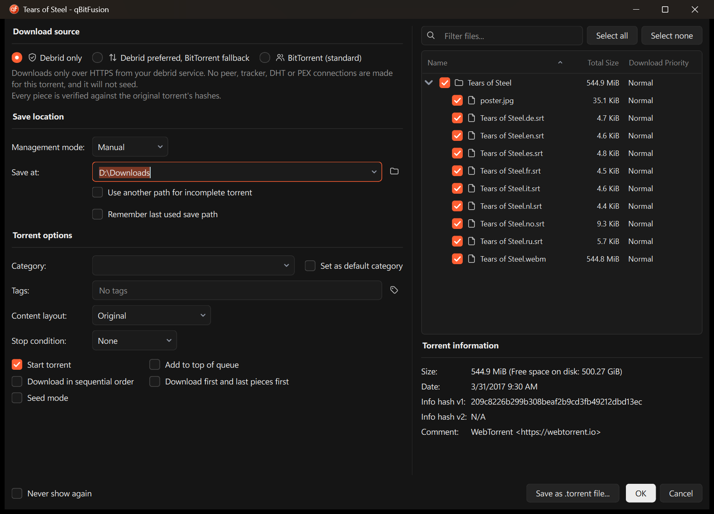
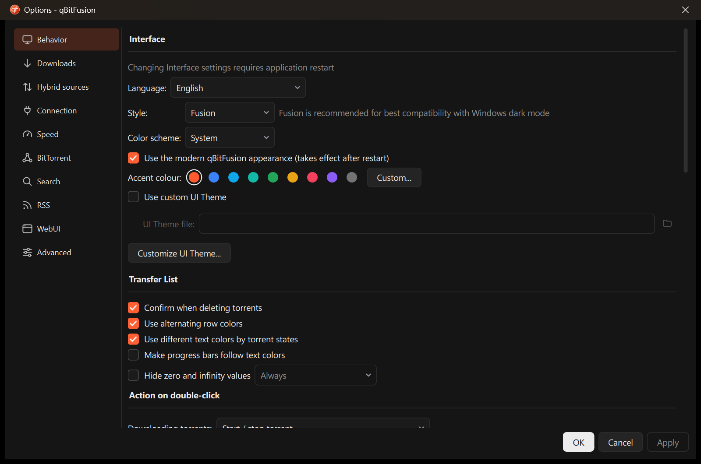

<p align="center">
  
</p>

<h1 align="center">qBitFusion</h1>

<p align="center">
  A fork of <a href="https://github.com/qbittorrent/qBittorrent">qBittorrent</a> 5.3 that can fill a torrent
  from a debrid account over HTTPS as well as from BitTorrent peers.
</p>



<sub>Screenshots use Creative Commons films. The downloads are real; the "HTTPS · Real-Debrid" source shown
for one of them is staged, because the demo files were not on a debrid account.</sub>

**Status: experimental.** It is built and tested on Windows only, supports one debrid provider
(Real-Debrid), and has been run against a real account by one person. Windows preview builds, when
published, are on the Releases page and are not code-signed; otherwise you build it from source. The
[limitations](#limitations) are listed in full below, and most of them are open work that a pull request
could take on.

## The idea

A debrid service holds a copy of a torrent's files and serves them over HTTPS. The usual way to use one is
a separate downloader: you get the files, but they are no longer connected to the torrent, nothing checks
them against it, and if the service fails half-way you start again somewhere else.

qBitFusion uses the debrid copy as one more source for the torrent itself. It requests byte ranges from
the provider, assembles them into pieces, and gives each piece to [libtorrent], which checks it against
the torrent's hashes the same way it checks a piece from a peer. The torrent keeps its info-hash, file
layout and resume data, so the two kinds of source can be combined in one download.

## Features

### Hybrid download

- Three sources, chosen per torrent when adding it and changeable later from the context menu:

  | Source | Behavior |
  | --- | --- |
  | Debrid only | HTTPS from the provider. No tracker, DHT, PEX or peer connections for this torrent, including for magnet metadata. It does not seed. |
  | Debrid preferred, BitTorrent fallback | HTTPS for what the provider has, peers for the rest. Falling back requires consent, because peers see your IP address. |
  | BitTorrent (standard) | Unchanged qBittorrent behavior. |

- Provider data is verified piece by piece against the torrent's hashes. Data that does not match is
  discarded.
- Verified pieces are kept when the source changes. A provider outage does not restart the download.
- Coverage is decided per piece: if the provider has only some of the torrent's files, it supplies the
  pieces it fully covers and the rest can come from peers.
- A **Source** column shows where a torrent's data is coming from and, when it is not the provider, why
  (for example "BitTorrent · not cached on Real-Debrid").
- Provider credentials are stored in the Windows Credential Manager. Tokens and signed links are kept out
  of settings files and logs.
- With the feature switched off, behavior is the same as qBittorrent's.



### Interface

- A header (pages, search, Add, quick toggles, one menu holding all the former menus) replaces the menu
  bar and toolbar. All of qBittorrent's functions are still there.
- Light and dark schemes that follow the system, with a configurable accent color.
- A monochrome icon set, a reworked add-torrent dialog, and restyled Options pages.
- Options > Behavior can switch back to the classic qBittorrent look.



## Limitations

What has been checked, and how:

- **Automated tests:** 32 suites pass on Windows. Ten of them cover the hybrid code, including end-to-end
  runs against a real libtorrent session and a local test server: HTTPS-only download of v1, v2 and hybrid
  torrents, rejection of corrupt data, an outage in mid-download, the consent rule, and a provider that
  has only part of a torrent.
- **Live use:** one Real-Debrid account and one large torrent, which completed over HTTPS at about
  10 MiB/s. That is the whole of the real-world evidence so far.

What is missing or unverified:

| Area | Limitation |
| --- | --- |
| Platforms | Only Windows 11 (MSVC, Qt 6.10.3, libtorrent 2.1.2) is built and tested. Linux and macOS have never been compiled. Other libtorrent versions are untested. |
| Providers | Real-Debrid only. v2-only torrents cannot use it. |
| Real-Debrid coverage | Not yet seen live: several selected files in one torrent, a link expiring during a transfer, OAuth token refresh, and adding a torrent to the account from the app. |
| Privacy | "Debrid only makes no swarm connections" is enforced in code and tested at the API level. It has not been confirmed with a packet capture. Your provider still knows what you download. |
| Debrid only | If the provider lacks part of a torrent, the download stops near the end and says so. It does not warn you at the start. |
| Speed | HTTPS downloads use four parallel requests per torrent by default. Whether that holds back fast lines has not been measured. |
| Statistics | "Downloaded" and session totals count only bytes from peers. Progress, speed and ETA are correct. |
| Web UI / Web API | No way to see or set the download source. |
| Interface | Reviewed at 150% scaling in the dark scheme. The light scheme and a few dialogs were changed but not re-checked. Labels inherited from qBittorrent still use Title Case, and some Options rows are unevenly aligned. |
| Translations | New text is English only. |
| Distribution | A portable zip for Windows, built by `qbitfusion/scripts/package-windows.ps1`. No installer, no code signing, no update check. |

[qbitfusion/docs/STATUS.md](qbitfusion/docs/STATUS.md) is the detailed version of this list,
[qbitfusion/docs/DECISIONS.md](qbitfusion/docs/DECISIONS.md) records the design decisions and the live observations,
and [qbitfusion/docs/SPECIFICATION.md](qbitfusion/docs/SPECIFICATION.md) is the design the transport was built from.

## Open work

These are self-contained enough for a pull request. Roughly in order of size:

- **Count HTTPS bytes in the totals** — `src/base/bittorrent/torrentimpl.cpp`, session statistics.
- **Warn at the start when "Debrid only" cannot finish** — the coverage is already computed in
  `src/base/hybrid/hybridcoordinator.cpp`; it only needs to reach the user earlier.
- **Interface clean-up** — sentence-case labels, Options row alignment, the last column on the Trackers
  and Peers tabs, a pass over the light scheme.
- **A test for the ETA calculation** with an HTTPS rate.
- **Measure and tune parallel requests** — see `Hybrid/MaxHttpPiecesPerTorrent`.
- **Another provider** — implement [`Hybrid::Provider`](src/base/hybrid/provider.h), using
  `providerrealdebrid.cpp` as the reference, with contract tests. No change to the coordinator should be
  needed; if one is, that is worth an issue first.
- **Linux and macOS** — get it to build, then add a credential store (Secret Service, Keychain) in
  `src/base/hybrid/securestore.cpp`. The CI workflows for both exist but are set to manual.
- **Web API and Web UI** — expose the source and its status.
- **Packet-level privacy check** — a harness that adds a "Debrid only" torrent and proves that nothing
  leaves for trackers, DHT or peers.
- **Releases** — a signed installer and a release workflow. A script for a portable zip exists
  (`qbitfusion/scripts/package-windows.ps1`).

[CONTRIBUTING.md](CONTRIBUTING.md) has the build steps and the rules a change has to follow.

## Building on Windows

Requirements: Windows 10 or 11, Visual Studio 2022 with the C++ workload, Git, Python 3, PowerShell 7.

```powershell
# once: builds the pinned toolchain into .deps (Qt 6.10.3, Boost, OpenSSL, libtorrent 2.1.2)
pwsh qbitfusion/scripts/bootstrap-windows.ps1

# build and run all tests
pwsh qbitfusion/scripts/build-windows.ps1

# build the optimized app and install it for the current user
pwsh qbitfusion/scripts/install-windows.ps1

# or build a portable zip into build-package
pwsh qbitfusion/scripts/package-windows.ps1 -Version 0.1.0-preview
```

The installed copy keeps its settings in a `profile` folder beside the program. It does not read or change
an existing qBittorrent profile and can run next to stock qBittorrent. To connect a provider, open
Options > Hybrid sources.

## Use

This is a download client. Use it for content you have the right to download and within your provider's
terms. It does not work around provider limits, blocks or takedowns, and changes that do will not be
accepted.

## Repository layout

The tree is qBittorrent's, kept as it is so that upstream releases can be merged. What this project adds
sits in a few places:

| Path | Contents |
| --- | --- |
| `src/base/hybrid/`, `src/gui/hybrid/` | The hybrid transport and its interface. |
| `src/gui/modern/` | The modern look: palettes, stylesheet, icons, shell widgets. |
| `test/testhybrid*.cpp` | Tests for the hybrid code. |
| `qbitfusion/docs/` | This project's documentation: status, decisions, specification, upstream guide. |
| `qbitfusion/scripts/` | Windows scripts: toolchain, build, install, package, test instance. |
| `qbitfusion/spike/`, `qbitfusion/tests/`, `qbitfusion/design/` | The libtorrent feasibility spike, the branding check, the logo source. |

Everything else is inherited, including some files that describe qBittorrent rather than this fork: `doc/`
(qBittorrent's man pages), `Changelog` and `INSTALL` (qBittorrent's), `dist/` (its packaging for other
platforms, unused here so far) and the translations in `src/lang/`. Edits to inherited files are kept small;
[qbitfusion/docs/UPSTREAM.md](qbitfusion/docs/UPSTREAM.md) lists them.

## Credits

qBitFusion is created and maintained by [Noel (CoderNoel)](https://github.com/CoderNoel).

It stands on [qBittorrent](https://github.com/qbittorrent/qBittorrent), the work of its [authors](AUTHORS) and
many contributors, and on [libtorrent] by Arvid Norberg.

## Relationship to qBittorrent

qBitFusion is based on qBittorrent `release-5.3.0` and keeps its history. It is a separate project and is
**not affiliated with or endorsed by the qBittorrent project**.

- Report qBitFusion problems here, not to qBittorrent.
- A bug that also exists in stock qBittorrent is better fixed upstream.
- qBittorrent is the work of its [authors](AUTHORS) and contributors. They accept
  [donations](https://www.qbittorrent.org/donate); this project does not.

[qbitfusion/docs/UPSTREAM.md](qbitfusion/docs/UPSTREAM.md) explains how upstream releases are merged, and where conflicts are
likely.

## License

GNU General Public License, version 2 or (at your option) any later version, with the OpenSSL linking
exception, the same as qBittorrent. See [COPYING](COPYING). Files added by this project carry the same
license.

The free [IP to Country Lite database] by [DB-IP] is used for resolving the countries of peers. The
database is licensed under the [Creative Commons Attribution 4.0 International License].

The films named in the screenshots, [Sintel], [Big Buck Bunny] and [Tears of Steel], are © Blender
Foundation and licensed under Creative Commons Attribution.

[libtorrent]: https://libtorrent.org/
[Creative Commons Attribution 4.0 International License]: https://creativecommons.org/licenses/by/4.0/
[DB-IP]: https://db-ip.com/
[IP to Country Lite database]: https://db-ip.com/db/download/ip-to-country-lite
[Sintel]: https://durian.blender.org/
[Big Buck Bunny]: https://peach.blender.org/
[Tears of Steel]: https://mango.blender.org/
