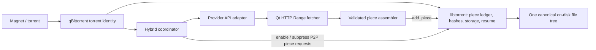
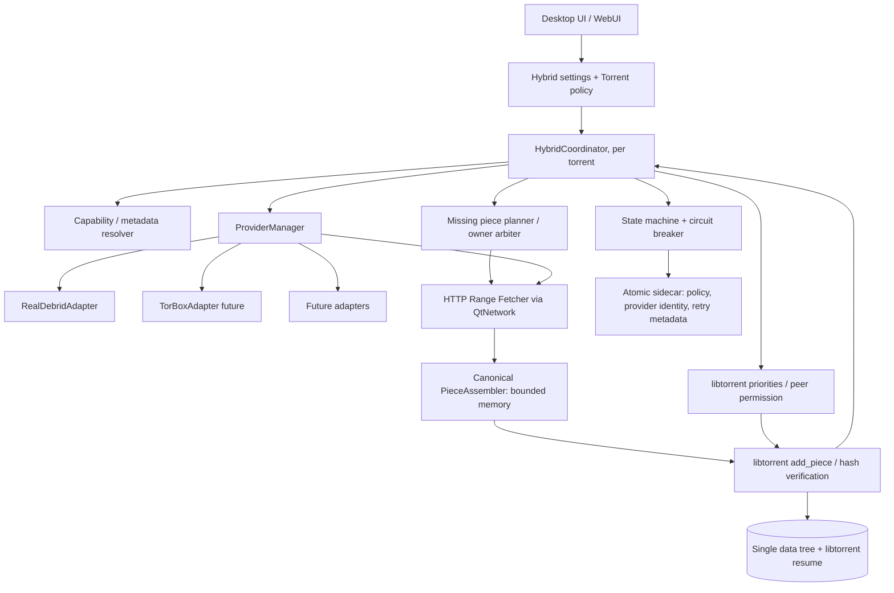
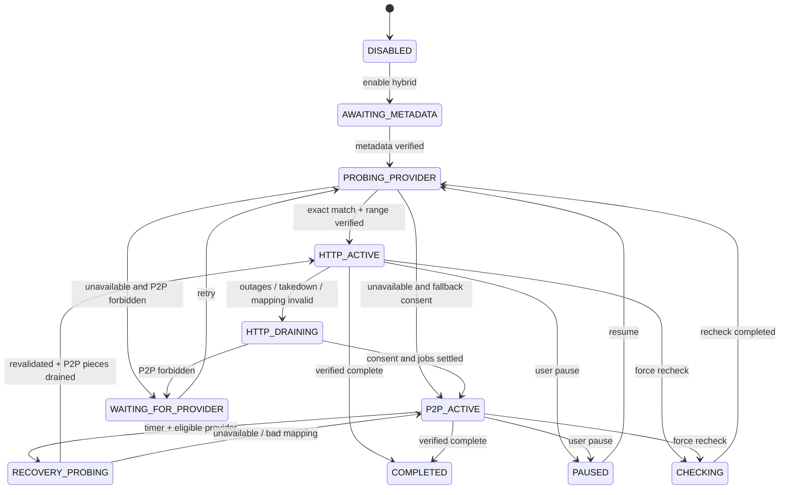

# qBitFusion design specification

This is the design the hybrid transport was built from. It was written before the implementation, as a
proposal, and is kept because the code, the tests and [DECISIONS.md](../qbitfusion/DECISIONS.md) refer to
its section numbers, test IDs (`T01`…), invariants (`I1`…) and gates (`G0`…).

Where this document and the code disagree, the code is current. What is actually built, tested and still
open is recorded in [STATUS.md](../qbitfusion/STATUS.md); decisions that changed the design are in
DECISIONS.md.

**Baseline:** qBittorrent `release-5.3.0`, libtorrent 2.1.x.

## Design rules

Every change to the hybrid transport has to respect these.

1. **Single source of truth.** libtorrent owns file storage, piece hashing and resume data. There is no
   second final-data tree, the info-hash never changes, and remote bytes are never written directly to a
   torrent's data paths.
2. **Verified progress only.** Every hash-verified piece is preserved across a change of transport. Partial
   in-flight data may be lost. Byte-perfect switching is not claimed until tests prove it.
3. **Privacy first.** Strict `debrid_only` generates no local swarm traffic, including metadata fetching.
   P2P fallback in `debrid_preferred` requires the user's explicit permission.
4. **No collisions.** Provider bytes are never knowingly submitted for a piece that peers are currently
   writing or downloading. `overwrite_existing` is not used for normal HTTP transfers.
5. **Reuse first.** qBittorrent, libtorrent, Qt and the system's credential facilities come before any new
   library. A new dependency needs a documented capability or performance gap.
6. **Pinned code.** APIs are checked against `release-5.3.0` and libtorrent 2.1.x. Compatibility with other
   versions is not asserted until tested.
7. **No secrets.** Provider tokens and signed URLs are never hard-coded, logged, shown in screenshots,
   committed or persisted outside the credential store.
8. **No bypass.** The program does not work around provider bans, 403s, takedowns, copyright restrictions
   or account limits.
9. **The existing app stays sound.** With the feature off, behaviour is upstream's. Changed lifecycle paths
   need tests.
10. **Proof, not prose.** Every claim about the implementation needs an executable fixture, a measurement
    or a reproducible manual protocol.

# Overview

## Architectural core, in one minute



**No duplicate on-disk output files. No file merging. No mutated infohash. No separate proxy or background server required.** The fallback path is the native libtorrent engine. The remote path is a bounded HTTP fetcher that hands *whole canonical pieces* to libtorrent for normal integrity verification.

## Constraints / honest guarantees

- **Guarantee sought:** never intentionally redownload a completed, hash-verified piece when switching transports; resume via libtorrent's persisted verified state.
- **Not a guarantee:** preservation of partial HTTP buffers or P2P blocks in flight, latency of detection, continuous availability, or content removed by both provider and swarm.
- **No speculative file matching:** providers must return precisely the torrent's canonical byte stream. File renaming/repacking or different releases are not interchangeable.
- **Privacy policy:** debrid-only and fallback-enabled modes are distinct; local swarm activity requires affirmative user choice.
- **Upstream friendly:** first implement an isolated, narrow core interface; avoid huge invasive patch sets and added dependencies without proof.
- **Legal:** use only content the user is authorized to download and obey providers' terms.

## Decision gates before implementation

| Gate | Proof required | If it fails |
|---|---|---|
| G0 | qBittorrent 5.3.0 builds and baseline tests run reproducibly | Fix environment, stop feature work |
| G1 | libtorrent `add_piece` correctly verifies external HTTP bytes and resumes after crash | Reassess core architecture |
| G2 | P2P↔HTTP switching avoids races and reuses *all verified* pieces | Revise arbitration; don't ship |
| G3 | Exact provider file mapping plus HTTP Range works with actual supported provider fixtures | Provider disabled, fall back if allowed |
| G4 | Debrid-only leaks **zero P2P connections**, including metadata discovery | Block release |
| G5 | Multi-file, v1/v2/hybrid, selected file, pad files and corrupt bytes tested | Clearly scope/disable unsupported shapes |
| G6 | Performance/memory and reliability measured with realistic fixtures | Tune with measurements, not guesses |
| G7 | Security and licensing review completed | Do not distribute |

---


# 00 | Project brief and success definition

## Mission

Make a mainstream native qBittorrent client intelligently source *identical torrent bytes* from either a debrid service over HTTPS or the local BitTorrent swarm, with integrity, seamless user-facing progress, reliable restart behavior, and user control over privacy exposure. Initially target Real-Debrid, then TorBox; use a provider-neutral interface to add others later.

## User story

> I add one magnet. If an exact cached copy is available through my debrid subscription, use it. If that service goes down at 30%, preserve my verified progress and resume the remaining pieces from peers when I have allowed local P2P. If debrid returns, prefer it for the remaining pieces. Do not create a duplicate download entry, redownload verified data, alter the torrent identity, or pretend P2P is private.

## Non-goals for MVP

- Downloading arbitrary URLs, YouTube/media extraction, Usenet, cloud file management, media transcoding, search indexing, bypassing takedowns, DRM circumvention.
- Running an HTTP server, replacing libtorrent, rewriting qBittorrent's UI framework, creating an independent database of downloaded torrent pieces.
- Transparent anonymous P2P or guaranteeing cache availability; no VPN or privacy claims.
- Parallelizing both sources for the *same piece* before safe arbitration is proven.
- Changing or sanitizing trackers/DHT on existing torrents by rewriting the `.torrent` metadata.
- Support for unverified archive-based provider responses, re-encoded assets or heuristically similar files.

## Roles and user personas

- **Ordinary user:** Adds a magnet and expects a reliable download, with understandable mode and recovery status.
- **Privacy-conscious user:** Explicitly chooses debrid-only; expects no local swarm activity including during metadata acquisition.
- **Advanced user:** Chooses between `Torrent only`, `Debrid only`, and `Debrid preferred, P2P fallback` per torrent, sees health, source and transfer activity.
- **Maintainer:** Needs minimal dependencies, typed contracts, testable interfaces, no credentials in logs, and a reversible default-off feature.

## Must-have behavioral contract

1. Keep original infohash and file tree; never remove and re-add a mutated torrent to swap transports.
2. libtorrent remains the only owner of verified piece state, disk layout, disk allocation, resume and final file integrity.
3. Externally fetched bytes enter libtorrent through a verified-piece ingestion path (`torrent_handle::add_piece` candidate), not direct writes into output files.
4. The coordinator may use the provider only after obtaining valid metadata, exact file mapping and a functioning byte-range endpoint. A magnet alone is not enough to map bytes.
5. Every HTTPS piece request is bounded, cancellable, time-limited, backpressured and limited by user speed settings.
6. If provider fails, only unverified or unfinished pieces become candidates for local P2P, and only with explicit P2P consent.
7. When debrid recovers, prevent overlapping writes and finish in-flight torrent pieces safely before handing remaining pieces back to HTTP.
8. A torrent's saved P2P permission and user file-selection intent survive restart and upgrades.
9. Provider credentials never become part of torrent metadata, saved resume data, WebUI JSON, exported diagnostics, or redirect logs.
10. Existing pure BitTorrent behavior is unchanged when the feature is disabled.

## Objectives and measurable acceptance

| Metric | Release gate |
|---|---|
| Verified-byte preservation | 100% of libtorrent-verified pieces remain valid across failover, crash and recovery in deterministic tests |
| Bit-for-bit correctness | 100% of completed fixture payloads match reference files; no silent mismatch |
| Detection-to-fallback scheduling | p95 under 2 seconds **after classified failure**, on a local test harness; network failure detection time is separately measured |
| Recovery scheduling | p95 under 5 seconds after a successful health probe and exact mapping verification in local tests |
| Privacy | Zero P2P network contacts in strict debrid-only fixture, including magnet metadata stage |
| HTTP memory bound | Configured in-flight byte cap is never exceeded in stress tests |
| Crash safety | Recovered torrent state never marks an unverified piece as complete |
| Existing behavior | qBittorrent baseline regression tests pass with feature off |

Targets are engineering acceptance criteria, **not** measured achievements or external performance guarantees.

## MVP scope priorities

**P0:** fixture-driven hybrid engine on a pinned build; actual libtorrent piece ingestion; Real-Debrid; strict metadata handling; manual policies; secure API tokens; seamless single torrent entry; outage recovery; crash-safe resume.  
**P1:** automatic bounce-back with hysteresis, TorBox, clear UI state, optional WebUI control, provider-specific rate-limit handling.  
**P2:** multi-provider prioritization, predictive provider selection, advanced schedules, independent download bandwidth attribution, fine-grained parallel hybrid throughput optimization.

## Product decision pending

The name `qBitFusion` is provisional. Do not rename application resources, product ID, bundle IDs or installers until the maintainer agrees on branding, distribution scope and possible upstream contribution.


---


# 01 | Functional specification and acceptance criteria

## User flows

### F01 | Add a magnet in Auto mode
1. User adds the magnet, sees one ordinary qBittorrent transfer item.
2. UI asks for transport policy (or applies existing explicit preference).
3. The client determines torrent metadata **without violating the P2P permission**. Metadata may come from a supplied `.torrent`, a verified provider metadata route, or permitted local P2P. Verify its v1/v2 infohash against the magnet.
4. The coordinator queries the chosen provider for cache status; don't equate cache status with file mapping or downloadability.
5. Validate canonical file list, exact sizes, byte-range behavior, permissions and destination.
6. If ready, download missing torrent pieces through provider HTTPS and submit them to libtorrent for verification.
7. If unavailable, choose P2P only when allowed, otherwise show a clear `Waiting for debrid` status.

### F02 | Provider stops after 30%
**Given** a 10 GiB, 4 MiB-piece torrent with 30% verified, and debrid returns repeated 503/timeouts, **when** the health classifier opens the circuit, **then**:
- HTTP in-flight work is cancelled/expired without overwriting verified pieces.
- Torrent piece priorities and allowed peer connections are restored in a bounded, nonblocking operation.
- libtorrent schedules only missing pieces, with progress derived from its verified state.
- The transfer remains a single qBittorrent entry, file set and infohash.
- UI displays `Switched to BitTorrent: provider unavailable` and accurately labels network/privacy source.
- HTTPS partial buffers may be discarded; partial P2P blocks may need re-fetch. Do not claim zero redundant network bytes.

### F03 | Provider comes back at 55%
**Given** original content remains byte-identical and byte-range accessible, **when** a scheduled non-invasive health check passes, **then**:
- Provider mapping is revalidated (or trusted only if still fresh under policy); reacquire URL as needed.
- Prevent active P2P-piece collision before injecting provider pieces.
- Reassign only missing and non-owned piece indices to HTTPS.
- Preserve 55% of previously verified pieces; never roll the progress indicator backwards because of transport choice.
- Do not continuously oscillate sources under flapping health.

### F04 | Strict debrid-only
- No P2P peer/tracker/DHT/PEX/LSD communication *for that torrent*, including metadata stage.
- If metadata cannot be obtained through a safe non-P2P source, display `Metadata unavailable without P2P`.
- When provider offline, remain paused/waiting rather than silently contacting peers.
- Do not change global qBittorrent network preferences or affect other transfers.

### F05 | Existing torrent converted to hybrid
- Snapshot existing verified pieces and file priorities, preserve torrent ID and infohash.
- If the required mapping cannot be established, leave existing torrent functional and report reason.
- Require explicit consent to suppress/allow P2P; don't treat enabling debrid as consent for later P2P traffic.

### F06 | Select files and rename paths
- Respect qBittorrent file selections and save paths. Provider filenames do not determine local output paths.
- Mapping is between original torrent *native file index* and provider file IDs/URL, not arbitrary basenames.
- Handle pieces spanning files, boundary data and pad-file semantics; defer unsupported mapping instead of guessing.
- Changing file priorities while downloading invalidates and recomputes the planned missing-piece queue.

### F07 | Pause, resume, remove, force recheck
- Pause cancels HTTP requests and makes no fresh P2P requests; resume honors policy.
- Remove cancels jobs, invalidates tokens/URLs in memory, removes sidecar metadata; preserve/remove data according to qBittorrent's existing remove options.
- Force recheck suspends `add_piece` until libtorrent's checking phase ends.
- Restart reloads provider policy from the sidecar, but verified pieces only from libtorrent's resume/recheck state.

## Policies

| Policy | Meaning | Peer activity | Metadata strategy |
|---|---|---|---|
| `torrent_only` | Existing qBittorrent behavior | Standard | Standard |
| `debrid_only` | HTTP provider or wait/error | **Forbidden** for this torrent | `.torrent` or provider-supplied, hash-verified |
| `debrid_preferred` | HTTPS when valid; P2P fallback when necessary | Explicitly allowed | P2P or provider |

Default for the new feature: **disabled**. When enabled, the first fallback activation requires a clear one-time or per-torrent consent. Never silently promote `debrid_only` to `debrid_preferred`.

## Errors the user must understand

`Provider unauthorized`, `Provider rate-limited`, `Uncached remotely`, `Provider fetching`, `Content unavailable`, `Metadata unavailable without P2P`, `Unmatched torrent files`, `Provider does not support byte ranges`, `No available swarm peers`, `Integrity verification failed`, `Waiting for retry`, `Disk error`, `Permission required for P2P fallback`.

## Source display and honest statistics

- One logical progress percentage: libtorrent verified/wanted piece accounting.
- Separate instantaneous rates: `HTTP ↓`, `P2P ↓`, `P2P ↑`; total download rate is **not** the same as libtorrent's P2P payload rate alone.
- Distinguish provider remote retrieval progress from local verified progress.
- Show percentage retained on failover; never display `100%` until verified complete.
- Avoid mislabeling HTTP bytes as peers, seeds, ratio or P2P downloaded counter.

## Accessibility and UX standards

Controls available in both desktop GUI and optionally WebUI; keyboard accessible, translatable labels, clear privacy warning, no new mandatory setup wizard when disabled. Informational status must not require colour perception alone.

## Explicit exclusions for first iteration

No auto-deleting remote provider items without user choice; no account sharing, provider circumvention, automatic switching between debrid subscriptions or torrent swarms whose metadata cannot be authenticated.


---


# 02 | Architecture: libtorrent remains the source of truth

## Design thesis

A two-downloader model (save HTTPS bytes separately, then recheck/move/merge files) makes failover expensive, brittle and race-prone. Instead, **the original qBittorrent torrent always exists in libtorrent**; its verified pieces, content storage and resume state are canonical. The HTTPS subsystem is an *alternate piece producer*, not an alternate file owner. Native peer-to-peer remains the fallback producer.



## Major boundaries

| Component | Owns | Must not own |
|---|---|---|
| `HybridCoordinator` | Mode, state, lifecycle and provider-selection policy | Direct file I/O, hash truth, permanent peer statistics |
| `PiecePlanner` | Set of candidate missing piece indices, source assignment, user priority mirror | Canonical completed-piece bitmap |
| `ProviderManager` | Authentication capability, provider IDs, availability, link refresh, rate limits | Torrent storage, peer connections |
| `HttpRangeFetcher` | Byte-range requests, timeouts, redirects, bounded buffers, throughput limits | Torrent paths or content verification claims |
| `PieceAssembler` | Torrent offset to provider file slices and exact full-piece bytes | Direct disk writes, cached piece validity flags |
| `TorrentImpl` bridge | Controlled libtorrent calls, alert routing, torrent state | Provider API details |
| libtorrent | Hash checks, all verified piece state, file layout, peer networking and resume | Provider OAuth/HTTP operations |
| Sidecar store | Policy, provider reference, nonsecret telemetry and retry state | Piece-complete claims, raw download URL, API keys |

## Target version / existing tools first

- `qBittorrent release-5.3.0` includes Qt6, a BitTorrent abstraction (`src/base/bittorrent/torrent.h`, `torrentimpl.cpp`), a session/alert route (`sessionimpl.cpp`), and existing settings/HTTP infrastructure.
- libtorrent 2.1.x has `torrent_handle::add_piece`, `get_download_queue`, `prioritize_pieces`, `have_piece`, `save_resume_data`, `torrent_info::files().map_block`, and alert types; build against exact pinned headers.
- Qt6 `QNetworkAccessManager` + `QNetworkRequest` + `QNetworkReply` provide asynchronous HTTP/HTTPS, cancellations, redirects and streaming. qBittorrent's existing `Net::DownloadManager` should be inspected before reuse; it may not meet range-streaming/backpressure requirements.
- Qt6 `QSaveFile` for atomic sidecar persistence, `QTimer` for retries and `QLoggingCategory`/existing log systems for observability.
- OS credential store abstraction via existing dependency if present; prefer system Keychain/DPAPI/Secret Service to building encryption.
- CMake + existing qBittorrent test infrastructure; do not introduce Rust, Electron, Python daemon, embedded server or new storage engine.

## Data plane: canonical piece ownership

1. Upon validated metadata, read torrent's `file_storage` mapping, piece length, file sizes, pad flags and selected files. Use **native libtorrent indices** as mapping truth; qBittorrent's user-visible list can differ due to filtered pad files.
2. Select a missing piece `p` not actively assigned to P2P and not already completed.
3. Compute all source slices using `file_storage::map_block(p, 0, actual_piece_size)`. v1 pieces can cross multiple files; v2 and hybrid have different edge/pad considerations.
4. Fetch each required slice through validated HTTP `Range: bytes=a-b` from its specific provider file link. Use a deterministic zero-filled slice only where torrent metadata explicitly marks a padding file, never as a guess.
5. Assemble the *exact* piece byte stream in a bounded in-memory buffer. Check response semantics and final lengths.
6. Call the wrapper around `torrent_handle::add_piece` with the complete piece (no overwrite flag) asynchronously. Do not report completion yet.
7. Wait for libtorrent's authoritative `piece_finished_alert` or hash failure (and relevant status synchronization) before accounting and scheduling dependent transitions.
8. Disk layout and resume remain unchanged. On crash, reconstruct from libtorrent; discard incomplete HTTP buffers.

## Control plane: source arbitration

Use an explicit arbiter and maintain per-piece short-lived ownership (`Unclaimed`, `HttpFetching`, `HttpSubmitted`, `P2PActive`, `Verified`). This is NOT an independent disk completion ledger. During pure HTTP preference, suppress P2P **download priorities** for pieces assigned to HTTP while preserving original *user file-selection preferences* in the coordinator. **Priorities alone are not a privacy control**: strict debrid-only also requires proven per-torrent prevention of metadata, tracker and peer traffic (Gate G4); if this cannot be achieved with the current native session integration, disable debrid-only rather than implying it is private. On provider failure, restore libtorrent priorities from the selection model. During P2P-to-HTTP switch, drain/avoid pieces already requested by peers (`get_download_queue`) before inserting external pieces. The exact libtorrent scheduler semantics **must be experimentally proven in Gate G2**.

Don't globally pause the libtorrent session as an approximation: doing so can break metadata, seeding, other torrents or externally injected pieces. Use per-torrent controls and verify their behavior in libtorrent 2.1.x.

## Thread and event ownership

- GUI/main Qt thread never blocks on HTTP or synchronous libtorrent handle queries.
- Async network workers use their own Qt event loop or the project's existing asynchronous network arrangement, with immutable request descriptors and cancellation tokens.
- All changes to torrent's transport policy and piece-owner state are serialized on one coordinator event loop; provider/network callbacks post messages rather than mutating state concurrently.
- Use generation/epoch IDs for callbacks: a late HTTP result from a previous transport generation must never be accepted after switching.
- `add_piece(vector<char>)` is preferred to raw pointer overload for asynchronous enqueue; bound pending vectors and alerts.

## Resource limits (initial tunable hypotheses, not benchmarks)

- Default 4 concurrent HTTP piece assemblies per torrent, global maximum 8; effective limit constrained by `maxBufferedBytes` (e.g. 64 MiB), and total pieces in flight; adapt to large piece sizes.
- Timeouts: connection 10 s; inactivity 15 s; whole request cap 120 s per range with progress-aware deadline. Must be configurable and tested rather than hard-coded blindly.
- HTTP Range requests should generally align to torrent pieces, not large arbitrary file segments, to avoid redundant reads when switching.
- Download speed limits: integrate qBittorrent's limits if API permits; otherwise explicitly account with a token bucket shared across HTTP transfers. Don't silently bypass user limits.
- Never schedule more data than available RAM budget; large pieces require streaming to a bounded staging mechanism or a documented maximum supported piece size. Do **not** write directly into libtorrent's data files.

## Recovery invariants

**I1** Original metadata identity and download destination do not change during switching.  
**I2** A progress increment occurs only from libtorrent-verified data.  
**I3** No two producers intentionally submit the same active piece concurrently.  
**I4** No provider may add bytes without exact torrent file mapping + HTTP byte-range validation.  
**I5** A debrid-only torrent must not contact the swarm even for metadata.  
**I6** After restart, provider status can be stale; libtorrent's hash-checked state is not.  
**I7** Disabled hybrid feature is behaviorally indistinguishable from upstream qBittorrent.

## Alternative architecture evaluated

**libtorrent Web Seeds / BEP 19** may reuse existing HTTP piece acquisition, but provider links are often per-file, expiring and dynamically authenticated. qBitdebrid uses a local proxy plus a *mutated/replaced torrent*, losing the guarantee of unchanged torrent identity; it also documents stalls. This route is a useful Gate G1 benchmark but is **not** the chosen MVP path. A later implementation may use authenticated URL seeds if it can preserve the exact original infohash and robustly refresh links. Do not build a local proxy or custom libtorrent storage plugin without evidence it is superior.


---


# 03 | Piece-transfer engine: normative technical spec

This document defines the hard part of the project. All source implementations must comply, including future provider adapters.

## 1. Terminology

- **Torrent identity:** Original v1 SHA-1 infohash and/or v2 SHA-256 infohash from libtorrent's verified metadata, not a provider's name or modified metadata.
- **Torrent virtual byte space:** Canonical byte-addressed stream represented by `file_storage`; may include pad files.
- **Provider file:** HTTP-addressable provider resource with provider-specific ID, size and temporary URL.
- **Verified piece:** A piece confirmed by libtorrent's hash validation and reflected in its session/resume state.
- **Partial data:** HTTP buffer or P2P block not verified as a whole piece. Never considered reusable progress.
- **Transport generation:** Monotonic event epoch per torrent, incremented on mode changes or remove; stale callbacks are dropped.
- **P2P outstanding:** A piece that libtorrent reports as currently being requested/assembled from peer blocks, or whose status cannot safely be determined.

## 2. Hard requirements

- Preserve original `torrent_info`; **never** rewrite the info dictionary, `.torrent`, tracker list, piece hashes, `file_storage`, or torrent root solely to use debrid.
- Full-piece input only to `torrent_handle::add_piece`; leave verification to libtorrent.
- Do not use `overwrite_existing` in normal download path. It may race with peer requests (libtorrent warns about this).
- Do not call `add_piece` during `checking_files`. Resume only after a corresponding completion transition.
- Do not rely solely on `piece_finished_alert` for immediate `have_piece == true`: libtorrent notes completion notifications may precede flushing; reconcile async status carefully.
- Use libtorrent native file indexes and `file_storage::map_block` for slice composition. Never compute torrent offsets by sorting provider filenames.
- A selected-file boundary may require bytes from an ignored file to complete a v1 piece. If exact data is missing, assign piece to allowed P2P or fail clearly.
- Changes to qBittorrent's file priorities can overwrite libtorrent piece priorities; reapply transport suppression on the coordinator after priority changes.

## 3. Recommended interfaces (illustrative, not compile-ready)

```cpp
struct TorrentIdentity { HashV1 v1; HashV2 v2; };
struct ProviderFile {
    QString providerFileId;
    QString canonicalPath;          // untrusted; only for matching, never storage
    qint64 size;
    bool byteRangeSupported;
};
struct FileBinding {
    lt::file_index_t nativeFileIndex;
    QString providerFileId;
    qint64 expectedSize;
};
struct PieceRequest {
    lt::piece_index_t index;
    int expectedLength;
    quint64 epoch;
    QList<RangeSlice> sourceSlices;
};
struct CompletedPiece {
    lt::piece_index_t index;
    std::vector<char> canonicalBytes;
    quint64 epoch;
};

enum class Owner { Unclaimed, HttpFetching, HttpSubmitted, P2PActive, Verified };

class ITorrentPieceSink {
public:
    virtual void submitPiece(CompletedPiece piece) = 0; // send to libtorrent thread
    virtual bool isChecking() const = 0;
    virtual void requestMissingPieceSnapshot() = 0;
    virtual void setP2PDownloadPriorities(/* computed overlay */) = 0;
};
```

API design note: avoid synchronous getters on GUI paths and avoid leaking libtorrent types into provider modules. Concrete Qt signal/method naming follows upstream style at the pinned release.

## 4. Piece assembly and file mapping

### Binding algorithm

For each torrent file in libtorrent native order:
1. Determine `size`, canonical normalized relative path and pad flag. Exclude pad files from provider binding; their bytes are defined by torrent metadata, not by HTTP.
2. Obtain provider manifest by *torrent resource*, not by blind loose filename search. Match exact normalized relative paths and sizes. Case-insensitive filesystems do not justify case-folding ambiguous remote paths.
3. Confirm no duplicate candidate and no path traversal (`..`, absolute drive letters, NUL, disallowed path segments); reject any ambiguous match.
4. For providers that rename or flatten paths, allow a **user-confirmed** mapping in a later iteration. MVP fails closed.
5. Validate every required file's HTTP range semantics. `Range: bytes=0-0` should yield `206 Partial Content` and a trustworthy `Content-Range` matching expected total size. Reject compression / transformation (`Content-Encoding` other than identity) and multipart surprises. Require 64-bit range handling. `HEAD` alone is insufficient.

### Assembly algorithm

```text
assemble(piece p):
  ensure metadata available and torrent not checking
  ensure p is wanted AND missing AND owned by HTTP, same generation
  size = actual_piece_size(p)                 # handle v2 edge pieces
  slices = file_storage.map_block(p, 0, size)
  allocate bounded pieceBuffer[size]
  for slice in slices (concurrent only if within memory+request budget):
      if pad_file(slice.file_index): fill the slice with zero bytes
      else:
          binding = exactFileBinding[slice.file_index]
          fetch exactly slice.length bytes at slice.file_offset via Range
          reject incorrect status/content-range/length/body transformation
          copy into canonical piece offset
  if cancellation or generation change: discard buffer
  if p is verified, P2P active, or checking: discard or defer
  mark p HttpSubmitted and submit add_piece(p, move(pieceBuffer))
  wait for libtorrent hash alert/status to mark Verified or reclaim on failure
```

**Important nuance:** `file_storage::map_file` maps file bytes to torrent pieces but libtorrent documentation warns about oversized requests (peer request data type). Prefer `map_block` when assembling a full piece, with explicit bounds. Pure v2 torrents and hybrid torrents may have distinct last-piece lengths; use the correct libtorrent API rather than assuming uniform piece size.

## 5. Scheduler and collision avoidance

**Preferred transport is a policy, not an absolute lockstep promise.** The coordinator reconciles a verified-piece snapshot, pending-HTTP map, and `get_download_queue` from libtorrent:

| Piece state | HTTP may fetch? | P2P may fetch? | On transition |
|---|---|---|---|
| Verified | No | No | Leave untouched |
| HTTP fetching | Yes | Suppressed | On failure release ownership |
| HTTP submitted, hash pending | No | Suppressed | Wait for libtorrent verdict |
| P2P outstanding | No | Yes | Let peer completion settle; do not force overwrite |
| Unclaimed missing | Yes in provider mode | Yes in fallback mode | Assign one source |

- **HTTP → P2P:** Cancel pending HTTP tasks, invalidate epoch, reclaim unsent pieces, restore wanted P2P priorities, leave verified status intact. Allow already submitted `add_piece` calls to resolve before prioritizing same pieces; protect with epoch + submitted-piece guard. Work at piece granularity; don't rewrite files.
- **P2P → HTTP:** Mark transition, snapshot active P2P queue; suppress new P2P piece requests where safe; drain or leave active pieces owned by P2P (bounded grace period); fetch only remaining missing, non-P2P-owned pieces. Avoid `overwrite_existing`. If libtorrent cannot provide reliable ownership, stay P2P until safe or disable automatic return for that torrent.
- **Both active in the network:** Hybrid may concurrently have HTTP requests for one set of pieces and P2P for a different set. Concurrency is safe only if arbitration and libtorrent priorities demonstrably prevent duplicate-piece writers.
- **On new file-priority/selection changes:** recompute wanted-piece mask, cancel newly unwanted HTTP tasks, apply new P2P priorities, preserve selections through restart.

### Scheduler pseudocode

```text
onEvent(event):
  serialize on coordinator event loop
  reject stale network callbacks if event.epoch != currentEpoch; always reconcile libtorrent alerts for pending submissions
  if event is providerFailure: classify and transition to fallback/wait
  if event is libtorrentAlert: reconcile piece status and release ownership
  if event is settingsOrFileSelectionChanged: rebuild intent and overlays
  if event is resumed: reconcile libtorrent, discard stale HTTP ownership

schedule():
  if state != HTTP_ACTIVE or torrentChecking: return
  for p in wantedMissingPieces ordered by user/sequential policy:
    if memoryBudget or concurrency exhausted: stop
    if owner[p] != Unclaimed or p in peerQueue: continue
    mark owner[p]=HttpFetching; dispatch async assembly(p, epoch)
```

## 6. Correctness around 30% / 55% scenario

Suppose piece length = 4 MiB and a 10 GiB torrent has 768 hash-verified pieces (30%). HTTP outage occurs. Those 768 pieces are already stored in libtorrent's single file tree; P2P need not fetch them again. Any single incomplete HTTP piece (up to 4 MiB) is not guaranteed to survive. Peers download missing pieces until 55% verified. Provider then recovers: completed pieces stay intact; currently peer-active pieces remain P2P-owned until settled; other missing pieces switch back to HTTP. The final completed torrent's bytes are validated against the original piece hashes.

This is not a promise of zero network retransfer of failed/in-flight bytes; it is a promise to preserve *verified* state.

## 7. HTTP details

- 64-bit `Content-Range` parsing; reject missing/malformed/mismatched offsets and totals.
- Verify exact byte count; `200 OK` to a nontrivial Range request is unsafe unless a documented, bounded workaround explicitly covers it. MVP rejects it.
- Follow only bounded HTTPS redirects to allowed, provider-authorized CDN hosts; credentials never forwarded to unrelated hosts. Check final scheme and reject `file:`, loopback, link-local, private IP and redirect-to-HTTP unless explicitly part of a validated trusted local test fixture.
- Rate-limit provider API separately from CDN HTTP data traffic; respect `429` and `Retry-After`.
- Reacquire expiring URLs after auth/link errors, not on every 206 chunk.
- HTTP timeout classifies a single request as retriable; source outage requires threshold and hysteresis.
- Implement cancellation and stale-callback suppression; never let a late callback submit bytes after torrent removal or file priority change.

## 8. Accounting and persistence

- Verified progress, piece bitmap, completion, ratio and torrent I/O remain libtorrent-owned.
- Track `http_bytes_received`, `http_bytes_submitted`, `http_verified_pieces`, `p2p_bytes`, `http_retry_bytes`, `switch_count`, `last_switch_reason` separately; do not double-count in authoritative progress.
- Persist policy, provider name, remote resource ID (if appropriate) and minimal backoff state atomically. Do not persist HTTP partial buffers in MVP.
- On restart, wait for libtorrent resume-data restoration or recheck before HTTP scheduling. Never rehydrate piece ownership from a stale sidecar.

## 9. Mandatory technical spike

Before implementing providers, write a tiny local fixture demo built against pinned libtorrent: generate a real 2-file torrent with a piece crossing the file boundary, ingest pieces via `add_piece`, observe hash alerts, stop/restart with resume data, cause a controlled 503 and demonstrate P2P completion, and then recovery from HTTP. Document real API behavior and measured races. Gate G1/G2 depends on this evidence. Do not confuse a mock implementation with proof.


---


# 04 | Hybrid state machine, failover, recovery

## Normative states

`DISABLED`, `AWAITING_METADATA`, `PROBING_PROVIDER`, `HTTP_READY`, `HTTP_ACTIVE`, `HTTP_DRAINING`, `P2P_ACTIVE`, `RECOVERY_PROBING`, `WAITING_FOR_PROVIDER`, `WAITING_FOR_USER`, `PAUSED`, `CHECKING`, `COMPLETED`, `ERROR`.

**State is per torrent**, persisted only as re-derivable policy and optional last reason; actual state is always reconstructed from libtorrent + current provider condition after restart.



## Classification: avoid flapping

**Providers return semantics; the coordinator determines transport strategy.**

| Condition | Action | Reason |
|---|---|---|
| Cached and validated, HTTP `206` works | HTTP active | Verified eligible source |
| Cache missing, provider remotely fetching | `WAITING_FOR_PROVIDER` or P2P depending user policy | Remote fetch is not local availability |
| `401`, invalid credentials | Stop provider requests; show auth action; fallback only with consent | Retry cannot fix credentials |
| `403`, content forbidden | Disable provider for this torrent; fallback only with consent | Do not try to bypass restriction |
| `404` from expired CDN link | Refresh link once per limited window | URL expiration vs content removal |
| `404` after successful refresh / unavailable resource | Source unavailable; fallback/wait | Possibly removed/takedown |
| `429` and `Retry-After` | Backoff; optionally P2P when allowed | Rate limit is not corruption |
| `5xx`, timeout, TLS connection failures | Failure counter and circuit breaker | Transient provider outage |
| `206` wrong Content-Range / changed size | Quarantine source, cancel HTTP, fallback/wait | Content integrity risk |
| Hash mismatch after `add_piece` | Quarantine file binding/provider, alert; recheck/reset and fallback only with consent | Corruption or wrong mapping |
| Disk failure | Pause all transfers, surface storage failure | Neither transport fixes disk |
| P2P unavailable + provider unavailable | Wait and retry with backoff | Avoid busy loop |

## Suggested defaults to test

- Open circuit after **3 qualifying failures** in a short window *or* strong permanent/content mismatch signal. Avoid failing over for one missed packet.
- Minimum source dwell time 30 seconds to prevent ping-pong (except permanent errors/user command).
- Recover by non-invasive provider availability check after exponential backoff starting at 30 s, doubling to 5 minutes, jitter ±20%. Respect `Retry-After` and documented rate limits. **Do not repeatedly add the same remote torrent** solely to probe.
- Require 2 successful non-mutating checks, or 1 real successful validated data range after a minimum hold, before switching back. Do not assume cached status implies the download URL works.
- Performance target begins only after outage classification, not from the first instant internet goes offline.

Numbers are **initial hypotheses** for controlled tuning. Do not bake them in as permanent wire compatibility.

## Atomic transition procedure

Each transition is an ordered transaction within one coordinator thread:

1. Freeze new piece assignment and increment transfer epoch.
2. Notify network workers to cancel uncommitted operations, accepting that Qt/network cancel is async.
3. Reconcile libtorrent's verified pieces, piece queue and pending `add_piece` submissions.
4. Change only relevant piece priorities, permission and provider source capability. Avoid global session state changes.
5. Release pieces owned by cancelled sources when safe; retain submitted hash-pending pieces until their verdict.
6. Change the visible state, schedule new candidates, persist policy/last reason and emit a structured source-switch event.
7. Ignore stale **network** callbacks with old epoch; always process libtorrent hash/completion alerts for submitted pieces that remain in the session, even if submitted under an older generation, so pending submissions are reconciled safely. Never allow stale work to resurrect removed jobs.

## Complicated edge cases

- **Pause during HTTP submission:** let libtorrent verdict resolve; don't mark done early.
- **Delete during provider request:** cancel and discard; no writes to removed torrent.
- **Very rapid 503 ↔ 206 cycles:** circuit breaker + dwell, respect rate limits.
- **Unauthorized provider and P2P disabled:** wait for user login; do not contact peer network.
- **Provider data changed under existing link:** `Content-Range`/length/hash mismatch quarantines it immediately.
- **Torrent's metadata or file selection changes mid-transfer:** require revalidation of bindings; do not accept old-generation pieces.
- **Provider recovers but P2P piece queue doesn't drain:** do not force re-switch or overwrite; continue P2P until a safe switching opportunity.
- **Seeding after completion:** seeding behavior remains under normal qBittorrent settings and opt-in network permissions. Debrid-only must not silently seed after download.

## Event and observability contract

Each transition event includes: torrent local ID (redactable), from/to state, UTC timestamp, reason enum, user mode, number of verified pieces, count HTTP in flight, count P2P pieces in queue. Log codes without API keys, URLs, magnet display names or torrent-specific hashes by default. UI messages are localized presentations of reason enums.


---


# 05 | Provider adapter contract and HTTP policy

## Interface segregation

Provider adapters manage **remote API semantics**, not HTTP piece downloading or torrent storage. The coordinator and core HTTP fetcher must be provider-agnostic.

```cpp
struct ProviderCapabilities {
    bool canCheckCachedWithoutMutation;
    bool canSupplyTorrentMetadata;
    bool canListFiles;
    bool providesPerFileDownloadUrl;
    bool supportsUserFileSelection;
    bool supportsLinkRefresh;
    bool canQueueRemoteTorrent;
};
struct Availability { enum Kind { Cached, RemoteFetching, Uncached, Removed, Unknown }; ... };
struct ProviderManifest { QString torrentResourceId; QList<ProviderFile> files; ... };
struct ProviderError { enum Category { Auth, RateLimit, Temporary, Gone, Permission, BadResponse }; ... };

class IDebridProvider {
public:
    virtual ProviderCapabilities capabilities() const = 0;
    virtual AsyncResult<Availability> checkAvailability(TorrentIdentity) = 0;
    virtual AsyncResult<ProviderManifest> resolveManifest(TorrentIdentity, Policy) = 0;
    virtual AsyncResult<TemporaryLink> resolveFileLink(QString resourceId, QString fileId) = 0;
    virtual AsyncResult<void> revokeOrForgetLocalReference(QString resourceId) = 0;
};
```

Types are illustrative. Actual async design must match Qt conventions and avoid blocking the GUI. Provider capability flags can vary by account tier/endpoint; determine at runtime as needed.

## Provider plan: Real-Debrid first

**Primary docs:** https://rest.real-debrid.com/ (current canonical API docs; verify OAuth endpoints before shipping).

Relevant documented operations: `POST /torrents/addMagnet`, `PUT /torrents/addTorrent`, `POST /torrents/selectFiles/{id}`, `GET /torrents/info/{id}` and an unrestrict workflow. The docs describe OAuth flows for open-source applications and explicitly warn not to bundle/distribute private API tokens for public apps. The API currently documents an overall request limit of 250/minute; this is not a throughput permission or an incentive to poll at that rate.

**Design:**
1. Authenticate with supported OAuth open-source flow, or a user-supplied token only in local private mode. Use OS secure storage and refresh/re-auth handling.
2. Determine a safe cached-status discovery approach; do not assume existence of an endpoint implies stable or comprehensive cache detection. Document gaps.
3. If remote torrent resource creation is required for download, explicitly warn that it is a *mutating provider operation* and may queue remote retrieval. Avoid repetitive creation during health probes.
4. Resolve remote selected file IDs from `torrents/info`, map exactly to torrent file paths + sizes, and request per-file links through documented API.
5. `unrestrict/link` and other response semantics require live sandbox validation. An API giving an HTTP URL does not guarantee byte ranges, file immutability, or correct mapping.
6. On any `404`/link expiry, one bounded refresh attempt before classifying as gone. Never bypass access denial or provider takedown.

**Known unknown / blocker:** Some provider endpoints may restrict cache availability queries or alter results. Real-Debrid adapter is not production-ready until it is tested with legitimate personal test fixtures and document allowed workflows under provider TOS.

## Provider plan: TorBox second

**Primary docs:** https://api-docs.torbox.app/ and https://api.torbox.app/docs.

TorBox documents cache-check endpoints, `createtorrent`/`asynccreatetorrent` (including `add_only_if_cached`), `mylist`, and `torrents/requestdl` with temporary CDN links. TorBox explicitly documents distinct per-minute and uncached-creation rate limits. It also documents file-related IDs within its torrent API. Avoid persisting expiring CDN URLs; refresh via authorized API.

**Special care:** TorBox's `mylist` may be cached/stale; `completed` isn't necessarily a declaration that every selected local byte has been downloaded. Read precise provider status and link rules. Cached availability is not proof of available, byte-identical files.

## Optional future adapters

AllDebrid, Premiumize, DebridLink etc. should use exactly the same capability and error interface. Do not copy third-party implementation code unless licences are verified; published API behavior is a guide, not evidence of GPL-compatible code.

## Provider-neutral contract

1. An adapter never returns raw credentials with normal values or logs.
2. A provider's `cached` response is advisory until manifest and Range verification succeed.
3. Any mutating request (add remote torrent, select files, delete resource) must be explicit in the capability flow.
4. Remote resource IDs are scoped to account and provider and aren't mixed between accounts.
5. Provider HTTP transfer paths are identity encoding with stable offset semantics; preflight `206` and exact length.
6. Access denial is final until user action or provider changes; do not attempt alternate endpoints to circumvent takedowns.
7. All network operations have cancellation, timeout, retry classification and a bounded response body.
8. Provider API traffic obeys per-provider rate limiter plus global limits; data plane has separate speed limiter.

## HTTP client (reuse Qt)

Start with `QNetworkAccessManager` and Qt network primitives. Validate qBittorrent's `src/base/net/downloadmanager.*` and any reusable request wrapper before creating a new one. A small specialized **range-transfer adapter** is appropriate if the existing manager buffers entire files or lacks per-request stream control.

Hardening requirements:
- HTTPS certificate verification enabled; no accepting all SSL errors.
- Only known API hosts for bearer credentials; signed CDN links should use no Authorization header unless specifically required by provider.
- On redirect, strip secrets and recheck scheme/host/IP; block redirects into loopback/private/link-local destinations outside deliberately constrained local tests. Protect against DNS rebinding.
- Set `Accept-Encoding: identity` and verify `Content-Encoding` and `Content-Range`; limit response total bytes and per-piece memory.
- Abort request if endpoint ignores Range and sends `200` unbounded body.
- Preserve 64-bit offsets, parse 416, 429, 503, 401/403/404 separately, and honor `Retry-After`.
- Enforce maximum connection count, total buffered bytes, backpressure, request deadlines and speed caps.
- No URL/token logging, no redirect chain in public diagnostics.

## Metadata and privacy

For `.torrent`, validate infohash and use original contents. For magnet, strict `debrid_only` mode must fetch verified metadata from provider if supported; otherwise refuse to start locally. Don't rely on qBittorrent's default peer-based magnet metadata retrieval in debrid-only mode. For fallback-enabled mode, libtorrent can retrieve metadata normally after explicit permission. No tracker/DHT/peer announcement before consent.

## Provider test protocol

Tests use a local mock service with exact API/error fixtures. Live tests require developer-owned lawful torrents (e.g. generated random bytes), consent to make provider requests, no credentials in CI, and no use of content or endpoints against terms. Record anonymous request/response *schemas*, feature support and range compliance, never tokens or full download links.


---


# 06 | qBittorrent 5.3.0 integration guide

## Baseline and branch discipline

Base from `https://github.com/qbittorrent/qBittorrent`, tag **`release-5.3.0`**. Record the exact commit SHA and submodule/dependency lock in the implementation PR, and preserve a fresh `upstream` remote. libtorrent 2.1.2 is the default distribution baseline; an alternate 1.2.x build exists, but do not promise parity until both are tested. Avoid coding against moving `master` while doing the prototype.

Upstream files to **inspect first**, not blindly patch:

- `src/base/bittorrent/torrent.h`, `torrentimpl.h`, `torrentimpl.cpp`: torrent abstraction, native handle bridge, piece/file status and URL seeds.
- `src/base/bittorrent/sessionimpl.cpp`, `sessionimpl.h`: session worker, alert event handling and torrent lifecycle.
- `src/base/bittorrent/torrentinfo.h`, `torrentinfo.cpp`: metadata and native/user index mapping (pad files may be hidden).
- `src/base/net/downloadmanager.h`, `downloadmanager.cpp`: reusable Qt HTTP transport and its limitations.
- `src/base/preferences.*`, and torrent-specific persistence components: settings, migration and saved state.
- `src/gui/` and `src/webui/`: preference, add-torrent and torrent-row UI hooks.
- `tests/`, `src/base/CMakeLists.txt`, root CMake: tests/build conventions.

*Paths and APIs are from public source review; verify against the pinned tag before altering anything.*

## Recommended new implementation folders (proposal)

```text
src/base/hybrid/
  hybridcoordinator.h/.cpp       # serialized state machine for one torrent
  hybridmanager.h/.cpp           # process-wide quotas, provider registry
  hybridpolicy.h                 # UI-independent modes/reason codes
  pieceplanner.h/.cpp            # missing pieces + ownership + priorities
  pieceassembler.h/.cpp          # torrent slices to full piece bytes
  rangesource.h/.cpp             # Qt HTTP Range with strict semantics
  provider.h                     # pure adapter interface + errors/capabilities
  provider_realdebrid.h/.cpp     # RD API adapter
  provider_torbox.h/.cpp         # later adapter
  securestore.h/.cpp             # OS credential storage boundary
  hybridsettings.h/.cpp         # sidecar schema + migration
  hybridmetrics.h/.cpp          # low-cardinality source events
```

Folder names are illustrative. Prefer current qBittorrent naming and build conventions. Avoid exposing adapter implementations to the GUI.

## Narrow wrapper around libtorrent

Prefer a private, asynchronous bridge from `TorrentImpl` to `HybridCoordinator` for:

1. Metadata ready / metadata failed, checking start/end, torrent started/stopped/removed.
2. A batched authoritative snapshot of wanted/missing pieces, piece length, native file mapping, piece priorities and `get_download_queue`.
3. `add_piece(index, std::vector<char>)` submission on the correct thread, with a tracked submit epoch and completion/failure alert.
4. Snapshot/apply user file priorities and temporary transport piece-priority overlay.
5. Notifications for rename, file selections, save path, torrent download mode, overall pause and file recheck.
6. Conservatively restore normal qBittorrent piece priorities if hybrid is disabled or faults.

**Do not** create a second `libtorrent::session`, raw direct file writer, independent torrent tracker engine, or bridge by polling WebUI HTTP back into the same process.

## Settings and persistence

- Global opt-in + provider IDs and source preference; per-torrent override; P2P fallback consent persisted distinctly.
- Use existing preferences infrastructure when possible. Store per-torrent nonsecret hybrid data in qBittorrent's supported torrent metadata extension or a sidecar named by stable torrent identity, after confirming existing facilities and migration behavior.
- Sidecar writes atomic via `QSaveFile`; schema-version it and validate after crash. No piece bitset; no raw CDN URL, magnet, bearer token, provider cookie, or OAuth secret.
- Tokens in OS secret store; switching accounts invalidates provider references and revalidates torrent binding.
- If old build opens profile, it should ignore extension safely. Prefer independent profile for dev testing to avoid risk to a user's normal client.

## Integration order

1. **No-op feature flag** compiles and passes existing tests; `torrent_only` path unchanged.
2. Add passive snapshot/alert bridge and inspect metadata+piece ownership in synthetic fixture.
3. Add local fake HTTP provider and piece assembly into `add_piece` without a real remote service.
4. Add P2P↔HTTP arbitration and restart safety with local swarm/HTTP simulations.
5. Add provider-specific API adapters only once core is demonstrated.
6. Integrate settings/UI, telemetry, WebUI addition with backward compatibility, then extensive security and performance tests.

## Compatibility guardrails

- Check qBittorrent's explicit support for libtorrent 1.2.x as an alternate. Put libtorrent-version-dependent calls behind thin compatibility helpers. **Never** silently compile code on 1.2 that is semantically different or cannot preserve guarantees.
- Existing torrent queue order, tracker behavior, RSS/search, categories, paths, incomplete-folder behavior, alternate speed limits, seeding rules, and WebUI scripts must remain unchanged unless user opts into hybrid.
- No per-torrent blocking `status()` call from paint/update loops. LibTorrent notes synchronous queries can block.
- Update CMake sources appropriately; avoid adding a second packaging/installer system until necessary.

## Build commands: starting point

```bash
git clone https://github.com/qbittorrent/qBittorrent.git
cd qBittorrent
git switch --detach release-5.3.0
git switch -c feature/hybrid-debrid
cmake -S . -B build -DCMAKE_BUILD_TYPE=RelWithDebInfo
cmake --build build --parallel
ctest --test-dir build --output-on-failure
```

Dependencies, Qt versions and test target availability vary by OS; review official `INSTALL` and the tag's CMake configuration. A bare `ctest` invocation may report no tests unless the project's test options are enabled. Record exact working commands in CI docs.

## Contribution cleanliness

Keep provider-specific code in an optional module, write tests alongside each new function, use qBittorrent's code style, keep one conceptual behavior per PR, and avoid a sweeping rename/rebranding commit. Mainstream acceptance is uncertain; upstream contribution may need to be split into neutral reusable hooks and separately maintained providers.


---


# 07 | Threat model and privacy requirements

## Sensitive assets

- Provider access/refresh tokens, API keys and device OAuth secrets.
- Temporary signed CDN URLs (credentials often embedded in query string).
- Torrent metadata, peer IPs, local download paths, private tracker passkeys.
- User's intention to **not** initiate local P2P communications.
- Integrity of downloaded bytes and local output file tree.

## Trust boundaries

| Boundary | Trust classification | Controls |
|---|---|---|
| Torrent/magnet metadata | Untrusted inputs | Hash-verified metadata, strict path validation, safe size arithmetic |
| Provider manifest/file names | Untrusted API data | Exact canonical mapping, no filesystem writes from remote paths |
| Provider API host | Remote trusted only for API contract, not byte integrity | HTTPS, host allowlist, auth scope, rate caps |
| CDN redirect target | Potentially untrusted | Redirect limits, TLS, SSRF controls, strip authorization |
| Local file tree | Security sensitive | libtorrent sole writer, path escape checks, symlink safety |
| WebUI remote client | Authenticated but possibly network exposed | Never export tokens or signed URLs, CSRF/session mechanisms inherited |
| Local swarm peers | Untrusted and IP-visible | libtorrent verification, explicit user permission |

## Primary risks and requirements

### A. No P2P leakage in debrid-only mode (release blocker)

- Treat **metadata discovery as P2P activity**: a magnet's infohash isn't a file mapping, and libtorrent can contact DHT/trackers/peers while obtaining metadata. Strict debrid-only mode must prevent those contacts for the torrent from the instant it is created.
- Obtain metadata from a supplied `.torrent` or approved provider response; validate original hash. If unavailable, remain inactive with explanatory status.
- Ensure no local peer announces, trackers, DHT, PEX, LSD, or fallback on provider error. Verify with instrumented session and packet-level tests.
- Do not imply that provider HTTPS always provides anonymity, or that ordinary VPN/proxy settings protect provider requests automatically; make routing explicit.

### B. Secret handling

- Use OS secure credential storage, not plaintext `.ini`, logs, resume/sidecar data or in-app manually constructed encryption.
- Real-Debrid docs warn against distributing a private API token in public applications; use documented OAuth flow, scopes and public client conventions.
- Restrict bearer credentials to the intended API host. CDN URL signing can itself confer access; never log or expose full URL.
- Credential removal/logout must invalidate cached handles and provider account state safely; no orphaned sensitive state.
- Check Qt redirects do not automatically propagate secret headers to new origins.

### C. Prevent arbitrary HTTPS requests / SSRF

- Provider APIs can return redirects or links. Do not let the application blindly request arbitrary URL schemes, localhost, RFC1918, link-local or metadata service endpoints.
- Allow only HTTPS public CDN destinations derived from trusted provider/API responses, with DNS/redirect revalidation. Local fixture servers are whitelisted *only in test builds*.
- Cap response sizes before allocation, timeouts, total redirect hops, decompress behavior, and parser complexity.
- Reject credential-in-URL in logs and user-visible errors.

### D. Integrity and source mismatch

- A `206` with matching `Content-Range` is still not proof of content. Mandatory final authority is libtorrent piece hash validation.
- Wrong size, ambiguous file mapping, transformed bytes, mismatched hash or unexpected pad semantics causes provider quarantine and lossless fallback when consented.
- Never trust provider's infohash label alone; verify original torrent metadata identity and content hashes.
- No direct writes to data files. No overwriting verified pieces on provider retries.

### E. Resource abuse

- Limits on concurrent provider API calls, byte-range requests, per-torrent and global memory, response bytes, outstanding piece submissions and exponential retries.
- Large piece sizes must not trigger unbounded allocations. Enforce checked integer arithmetic and safe conversion.
- Ensure one failing provider cannot stall qBittorrent's event loop or unrelated torrents.
- Cancellation races on torrent remove/priority changes are security as well as correctness bugs.

## P2P privacy consent UX

Proposed one-time notice: **“If debrid is unavailable, this torrent may connect to BitTorrent peers. Peers and trackers may see your IP address. You can choose ‘Debrid only’ to prevent local P2P activity.”** The user must knowingly select fallback mode; do not bury the effect in a generic “automatic” toggle. Respect existing qBittorrent interface-binding and proxy settings but do not assume they guarantee anonymity.

## Review and validation checklist

- [ ] Inspect all network and OAuth redirect paths; validate TLS and host/IP rules.
- [ ] Confirm zero swarm packets in strict mode, including while magnet metadata is unknown.
- [ ] Confirm no tokens/signed links in logs, crash dumps, debug UI, WebUI API or backtrace excerpts.
- [ ] Fuzz torrent file paths, provider manifest, Content-Range, redirect chains and resume sidecars.
- [ ] Confirm remote `403`/removal is handled as denial, not bypassed.
- [ ] Confirm no elevated filesystem permissions or new listening TCP socket introduced.
- [ ] Test user-selected file exclusion, path traversal, symlink and filesystem rename behavior.
- [ ] Run static analysis, compiler sanitizers, leak detection and dependency licence review.


---


# 08 | Testing, benchmarking and release gates

## Philosophy

Build the core using completely deterministic, locally generated test torrents and mock provider servers. Prove a download is the *same bytes and the same torrent identity* after every failure. Real provider smoke tests come last, with developer-controlled lawful files, never in public CI.

## Test environments

- **Baseline:** pinned qBittorrent 5.3.0, libtorrent 2.1.x, Qt6, isolated user profile.
- **Swarm:** local libtorrent seed/peer harness in an isolated network; no public tracker or unsolicited external connections.
- **Provider:** local HTTP server with deterministic manifest, `206` Range support, configurable expiry, 404/403/429/503, slow/aborted responses, TLS and corrupt bytes.
- **Faults:** kill/terminate process, crash injected between HTTP completion and `add_piece`, restart during checking, disk full, permission denied, network partition.
- **Matrix OS:** Linux CI primary; Windows and macOS native acceptance builds later. Add libtorrent 1.2.x compatibility only after feature works on default 2.1.x.

## Required deterministic fixtures

| ID | Fixture | Purpose |
|---|---|---|
| T01 | Single 32 MiB file, v1 | Range, injection, completion |
| T02 | Three files of non-piece-aligned sizes, v1 | Piece crosses file boundaries |
| T03 | v2-only torrent, file end pieces | Different end-piece sizes, file mapping |
| T04 | Hybrid v1/v2 torrent with pad files | Hash behavior and zero pad slices |
| T05 | One selected file, adjacent files ignored | Piece boundary requiring ignored bytes |
| T06 | Renamed local file, matching remote original | Remote mapping remains metadata-based |
| T07 | Two same-name/same-size paths | Ambiguous provider mapping refused |
| T08 | Empty files, unusual Unicode and very long paths | Parser and path correctness |
| T09 | Sparse >4 GiB logical offsets | 64-bit Range, arithmetic overflow |
| T10 | Provider returns transformed/repacked file | Reject invalid or hash mismatch |
| T11 | Corrupt one byte in a piece | libtorrent hash failure and recovery |
| T12 | 10 GiB synthetic streaming data | Resource and recovery stress (do not keep all in RAM) |

Fixtures must be reproducible with a checked-in generator and deterministic seed, with reference `SHA-256` of final files. Use small fixtures for ordinary CI; large stress tests nightly.

## Critical scenarios (behaviour-driven)

### A. HTTP-only success
Given metadata is valid, provider returns exact bytes by Range, and P2P is forbidden, when the torrent completes, then full output hashes match, zero local peer connections occur and `qBittorrent` shows one transfer.

### B. At 30%, provider 503
Given 30% verified from HTTP and P2P fallback consent, when the provider fails repeatedly enough to open circuit, then existing verified pieces remain available, P2P begins on missing pieces, all file hashes ultimately match, and the original infohash is unchanged. Assert verified-piece retention = 100%; measure wasted in-flight bytes separately.

### C. At 55%, provider restored
Given 55% verified by mixed sources, when provider passes health tests, then HTTP resumes only for missing, non-P2P-owned pieces and completed data persists. Verify no `overwrite_existing` use and no active double-writer piece collisions.

### D. Crash 31% / restart
Kill process while HTTP piece in flight. On restart, libtorrent resume or recheck reconstructs verified bitmap; no stale HTTP state is trusted, and file output is correct.

### E. Privacy leak
Start strict debrid-only from a magnet *without metadata*. Provider unavailable. Assert packet capture shows zero DHT/PEX/trackers/peer announces for this torrent and error explains metadata dependency. Test every transition including provider failure and app restart.

### F. HTTP poisoned response
Server sends `200` to Range request, wrong `Content-Range`, compressed body, off-by-one total or content mutation. Assert no piece is incorrectly marked verified, provider quarantined and user notified.

### G. Priority change during transfer
User unselects a file while HTTPS requests are in flight, then reselects it. Assert no unintended selected-file completion, stable local paths and coherent qBittorrent wanted bytes.

### H. Provider credentials and rate limits
Expire token/return 401; stop the API loop, ask for login, never leak tokens. Return `429 Retry-After`; respect it. Temporary `404` link refreshes once, permanent 404 falls back/waits.

### I. Peer collision stress
Introduce slow P2P blocks and simultaneously recover provider. Assert piece ownership exclusion, no data corruption, no `overwrite_existing`, bounded memory and eventual liveness.

### J. Feature-off regression
Build normal qBittorrent, set feature off, and compare session semantics, torrent lifecycle, file priorities and WebUI response compatibility with clean upstream build.

## Unit-level tests

- Piece offset/slice mapping, incl. pad bytes, v2/hybrid edge cases.
- Cache/status error classifier; expiry and rate limiter.
- URL redirect, Content-Range and 64-bit offset parser fuzzing.
- State machine deterministic event sequences and generation tokens.
- LRU/in-flight ownership, cancellation and double-submit prevention.
- Secret-store failure and profile migration; sidecar truncation/atomic write.
- Provider manifest ambiguous/missing/mismatched filenames and sizes.

## Performance and observability

Instrument `switch_detection_ms`, `switch_schedule_ms`, `http_goodput`, `p2p_goodput`, `duplicate_network_bytes`, `verified_reuse_bytes`, `hash_fail_count`, `http_heap_peak_bytes`, `pending_add_piece_count`, `HTTP 429`, provider API calls/min, disk I/O and CPU. Avoid user-identifying torrent names/hashes in default event payloads.

Suggested initial benchmark profile: 1, 4, 8 and 16 HTTP concurrent piece requests; range request sizes aligned to piece boundaries; 1 GiB and 10 GiB fixtures; memory caps at 32/64/128 MiB. Plot throughput vs CPU/peak RAM, retries, read/write amplification, and failover latencies. **Choose concurrency by measured throughput and QoS**, not assumptions.

## Sign-off conditions

- All G0–G7 gates in README satisfied.
- Every P0 scenario above passing repeatedly on a pinned local test harness.
- No unresolved data-corruption, token exposure or P2P privacy leak defects.
- Reproducible build and test commands documented with commit SHA and dependency versions.
- Document exact unsupported cases and failures; no blanket “flawless” claims.


---


# 09 | Implementation roadmap, work packages, dependencies

## Rules of execution

- **No source changes before Gate G0** (pinned baseline reproducible) and a review of upstream coding guidelines.
- **No provider implementation before Gate G1/G2** demonstrates correct external piece ingestion and source switching with a local HTTP fixture.
- Keep commits focused, include tests in the same PR, reject “works on my machine” claims without fixtures.
- No release until security/privacy gate G4 and artifact licence gate G7 pass.
- Phase estimates intentionally omitted: changes depend on actual API compatibility, OS build access, and measured scheduler behavior.

## Dependency graph


## Milestones and definition of done

### Phase P0 | Repository reconnaissance + pinned build
**Owner:** Core engineer + build engineer.  
**Output:** `REPO_RECON.md`, reproducible build scripts, exact toolchain versions, working tests, baseline benchmark and appropriate dev profile.  
**Done:** qBittorrent starts with a normal test torrent, original tests run, paths to metadata/alerts/priorities/network/settings confirmed against tag; licensing notices recorded.

### Phase P1 | Libtorrent feasibility spike (hard gate)
**Owner:** Libtorrent engineer.  
**Output:** test harness demonstrating `.torrent` and magnet metadata resolution, exact piece mapping, `add_piece`, hash failures, resume and peer fallback with two non-piece-aligned files.  
**Done:** Show a 30% HTTP→P2P→HTTP flow without re-download of verified pieces and no concurrent overwrite in test, or file a blocking technical ADR explaining why not. If libtorrent semantics cannot support safe overlap, choose serialized source mode rather than risking corruption.

### Phase P2 | Core integration
**Owner:** qBittorrent integration engineer.  
**Output:** opt-in feature flag, per-torrent controller, nonblocking libtorrent bridge, snapshots, cancellation epochs and structured events, no UI required.  
**Done:** Builds with feature disabled and enabled; correct event ownership and no regressions to existing torrents.

### Phase P3 | Provider-neutral mock HTTP engine
**Owner:** HTTP/protocol engineer.  
**Output:** `PieceAssembler`, `HttpRangeFetcher`, fake adapter, manifest mapping validator, bounded memory, local mock HTTP server.  
**Done:** v1/v2/hybrid reference test data downloaded via `add_piece` with hashes verified, response validation and faults exercised.

### Phase P4 | Automatic failover and durable resume
**Owner:** State-machine engineer in coordination with P1/P2.  
**Output:** source arbiter, classified error states, circuit breaker, recovery probes, sidecar persistence and user permissions.  
**Done:** deterministic 30% outage and 55% recovery, crash tests, no duplicate verified bytes, zero active piece collisions in stress tests.

### Phase P5 | Real-Debrid integration
**Owner:** Provider engineer.  
**Output:** Real-Debrid API adapter, OAuth/on-device credential handling, supported cached/uncached semantics, file mapping and URL refresh, rate limiting.  
**Done:** compliant fixture tests and developer-owned live smoke test; redact all secrets; documented API limits and unsupported cases.

### Phase P6 | Security and QA hardening
**Owner:** Security/QA engineer (independent from the implementer).  
**Output:** threat-model verification, packet-level debrid-only tests, fuzz cases, sanitizer CI, failure matrix and bug reports.  
**Done:** no critical defects, all mandatory privacy and data integrity gates pass.

### Phase P7 | User interface and WebUI compatibility
**Owner:** UI/WebAPI engineer.  
**Output:** settings, add-dialog transport policy, per-torrent mode and status, clear privacy permission, source-specific rates, backward-compatible optional WebUI extension.  
**Done:** no misleading progress, keyboard accessible and translatable, no changes with feature disabled.

### Phase P8 | TorBox + benchmarking
**Owner:** Second provider engineer + performance engineer.  
**Output:** TorBox adapter, shared fake provider compliance suite, rate-limit/expiry behavior, performance report and tuned defaults.  
**Done:** provider consistency, benchmark comparison, bounded memory under 10 GiB synthetic fixture and no regressions.

### Phase P9 | Documentation and release/upstream
**Owner:** Lead/maintainer.  
**Output:** changelog, user guide, support matrix, contributor docs, licence/attribution and upstream-compatible PR plan.  
**Done:** all gates signed and verified release builds with reproducible dependency manifests.

## Parallelizable workstreams

- **Parallel after P0:** QA fixtures/test server, provider API contract research, UI mockups, legal review. Do not merge code changes until interfaces are frozen.
- **Parallel after P1:** core bridge, HTTP fetcher, secure store, manifest validation, state machine unit tests.
- **Serial coordination points:** libtorrent wrapper contract freeze, piece ownership algorithm freeze, settings schema migration, provider integration gate, release candidate.

## Issue backlog

| ID | Task | Depends on | Acceptance |
|---|---|---|---|
| CORE-001 | Build qB 5.3.0 and record baseline | None | CI green + version lock |
| CORE-002 | Spike native `add_piece` + alerts | 001 | Verified-piece test passes |
| CORE-003 | Map v1/v2/hybrid file slices | 002 | T01–T05 passing |
| CORE-004 | Missing-piece and owner arbiter | 002 | No duplicate submissions |
| CORE-005 | Priorities snapshot and restore | 002 | File selection respected |
| NET-001 | Strict HTTP Range parser and streaming | 001 | 200/206/416/fuzz tests |
| NET-002 | Bounded per-piece assembler | 003, NET-001 | Memory cap + correct bytes |
| NET-003 | Retry, backpressure, quota scheduler | NET-002 | 429/timeout tests |
| PROVIDER-001 | Provider capability contract | 001 | Test doubles compile |
| PROVIDER-002 | Real-Debrid implementation | PROVIDER-001, NET-003 | Legal live smoke test |
| PROVIDER-003 | TorBox implementation | PROVIDER-001, NET-003 | Legal live smoke test |
| STATE-001 | HTTP↔P2P state machine | CORE-004, 005, NET-003 | 30→55 scenario |
| STATE-002 | Resume/sidecar + migration | STATE-001 | Crash tests |
| SEC-001 | Credential/redirect hardening | NET-001 | No secret exposure |
| SEC-002 | Strict debrid-only metadata path | 002, PROVIDER-001 | Zero swarm packets |
| UX-001 | Opt-in policy and privacy warning | STATE-001 | Permission preserved |
| UX-002 | Rate display, errors and WebUI | UX-001 | No API regression |
| QA-001 | Local swarm and HTTP fault simulator | 001 | Reproducible cases |
| QA-002 | Load, sanitizer and audit gate | All | G0–G7 report |

## Review template (every PR)

1. Scope, baseline commit, user impact, linked requirement and ADR.
2. Reused upstream APIs and why new code is necessary.
3. Files changed and thread-safety implications.
4. Tests with exact command/result, including negative tests.
5. Privacy implications and token path audit.
6. Benchmark/memory results if on data plane.
7. Risks and rollback behavior with feature disabled.


---


# 10 | UI, WebUI and configuration specification

## Design principle

Keep qBittorrent recognizably qBittorrent. Avoid a second downloads page or a separate “debrid queue.” A torrent remains a torrent; transport choice is a per-torrent property. New controls should be progressive disclosure and disabled by default.

## Global preferences

Proposed section **Downloads > Hybrid sources**:

- `[ ] Enable debrid providers` (default off)
- Provider accounts: Add Real-Debrid / TorBox; Sign in, Re-authenticate, Disconnect, Test access
- Default transport policy: `Torrent only`, `Debrid only`, `Debrid preferred (P2P fallback)`.
- A distinct setting controlling P2P permission for newly added hybrid torrents, never automatically inferred from provider credentials.
- Maximum HTTP concurrency / global memory cap / provider retry policy advanced settings; safe defaults, warning on overcommit.
- Whether to leave remotely created provider torrents on provider account after local completion; default retain unless provider rules require otherwise.

## Add torrent dialog

Use existing magnet/file input and file selection. Optional `Download source` selector (when feature enabled):

- `BitTorrent (standard)`
- `Debrid only` (shows *no peer connections*, but metadata availability caveat)
- `Debrid preferred with BitTorrent fallback` (shows explicit privacy consent)

A standalone `.torrent` can supply verified metadata without swarm. A bare magnet may need provider metadata or permitted P2P. Never imply debrid-only magnet always works.

## Torrent details row and status

- Small `Source` label: `HTTP / Real-Debrid`, `BitTorrent`, `Switching`, `Waiting for provider`, `Checking`.
- `Progress`: uses libtorrent verified/wanted accounting, not provider remote progress.
- `Download rate`: optionally show `HTTP` and `P2P` contributions; `Upload` always P2P and only if allowed.
- `Provider status`: Cached, Fetching remotely, Not available, Rate-limited, Authentication required, Content restricted.
- `Recent switch`: human-readable reason with time; privacy indicator when P2P fallback active.
- Do not abuse warning colours. Clear accessible textual state.

## Suggested WebAPI additive extension (draft only)

**Do not edit core API semantics unless maintainers approve.** Prototype new endpoints under existing `/api/v2/` version in an optional module, inheriting qBittorrent authentication and CSRF protections:

```
GET  /api/v2/hybrid/providers          -> capabilities and connection state (NO SECRETS)
GET  /api/v2/hybrid/torrent?hash=...    -> mode, source, errors, speeds, permission
POST /api/v2/hybrid/torrent/setMode    -> torrent hash + enumerated mode + fallbackConsent
POST /api/v2/hybrid/provider/connect   -> start supported credential flow, never echo token
POST /api/v2/hybrid/provider/disconnect-> delete secure stored credentials, confirm
```

This endpoint list is *proposed design*, not a claim that it already exists. API naming, routing, authentication model and schemas require compatibility review. Avoid adding a generic endpoint that lets WebUI issue arbitrary HTTP fetches.

## Proposed nonsecret status schema

See `contracts/hybrid-status.schema.json`. Fields are additive: 

- `mode`, `state`, `active_transport`, `provider_name`, `provider_status`
- `verified_bytes`, `wanted_bytes`, `http_bytes_received`, `http_rate_bps`, `p2p_rate_bps`
- `p2p_fallback_approved`, `last_transition`, `error_code`, `retry_after_seconds`

Infohash in URL is already supported by qBittorrent WebUI patterns; avoid returning secrets or full torrent file paths to clients without existing permissions.

## Configuration example (illustrative only)

```ini
[Hybrid]
Enabled=false
DefaultMode=torrent_only
MaxGlobalHttpRequests=8
MaxHttpRequestsPerTorrent=4
MaxBufferedBytes=67108864
RecoveryMinDwellSec=30

# Never store access tokens or signed URLs here.
```

Actual preference key naming/storage must follow upstream infrastructure and migration conventions. Explicit user choice takes priority over defaults.

## Notification texts

- `Using Real-Debrid. Remaining pieces will be verified against the original torrent.`
- `Real-Debrid is unavailable. Switching remaining pieces to BitTorrent. Peers may see your IP address.`
- `Real-Debrid is available again. Finishing outstanding peer pieces, then returning to HTTPS.`
- `This debrid file does not match the torrent's file layout. No HTTP data will be used.`
- `Debrid-only mode is waiting. Torrent metadata cannot be obtained without contacting peers.`

Never use a blanket “no VPN needed” marketing claim.


---


# 11 | Architecture decision records (ADRs) and unresolved gates

## ADR-001: libtorrent owns all disk data and verification
**Status:** Proposed / conditional on Gate G1.  
**Decision:** External HTTP bytes are assembled into complete torrent pieces, submitted through `torrent_handle::add_piece`, and accepted only after normal libtorrent hashing.  
**Why:** No duplicate file tree, no cross-transport file merging, existing resume/hash engine reused.  
**Tradeoff:** Need full piece buffers and careful source arbitration.  
**Reject:** Custom disk storage backend and HTTP file writer as first implementation.

## ADR-002: keep original infohash and torrent metadata
**Status:** Accepted requirement.  
**Decision:** No mutated `.torrent`, no fake web seed info dictionary, no removing/re-adding a replacement torrent.  
**Why:** Guarantees continuity of piece checks, peer fallback and user state.  
**Consequence:** Provider-to-torrent file mapping must be exact and explicit.

## ADR-003: start with Qt HTTP, not a custom HTTP stack
**Status:** Proposed / validate in Gate G3/G6.  
**Decision:** Use existing Qt network primitives (`QNetworkAccessManager`, `QNetworkReply`) and possibly reusable qBittorrent network facilities.  
**Why:** Native dependencies already present, asynchronous and cross-platform.  
**Exit clause:** Only introduce libcurl multi or a specialized fetch engine if controlled benchmarks demonstrate material improvement, and separately review licensing, package footprint and maintenance cost.

## ADR-004: debrid-only cannot silently become P2P
**Status:** Accepted requirement.  
**Decision:** Fallback must be an explicit policy with an informed consent notice.  
**Why:** Changes the network privacy model and peer-visible IP exposure.  
**Consequence:** A magnet with no non-P2P metadata source may wait instead of downloading.

## ADR-005: metadata and file binding before HTTP
**Status:** Accepted requirement.  
**Decision:** Validate torrent identity, full needed file mapping, byte ranges and safe URL behavior before assembling source pieces.  
**Why:** Provider cache labels alone are insufficient; same filename can be different data.

## ADR-006: policy sidecar only, not a second resume database
**Status:** Proposed.  
**Decision:** Persist source preferences and provider references atomically; libtorrent is the sole completed-piece ledger.  
**Why:** Reduces conflict and crash-recovery complexity.  
**Risk:** Need migration handling for saved qBittorrent torrents and rename/move behavior.

## ADR-007: no simultaneous writing of the same piece
**Status:** Accepted requirement; mechanism TBD at Gate G2.  
**Decision:** Source ownership and queue snapshots prevent P2P `add_piece` races; if reliable ownership isn't possible, use serialized transitions or remain P2P until safe.  
**Why:** libtorrent documents hazards with `overwrite_existing` while peers download.  
**Consequence:** Source switches may be delayed to drain in-flight work.

## ADR-008: start narrow and upstream-friendly
**Status:** Proposed.  
**Decision:** Feature flag, isolated module, smallest hooks, provider-neutral abstraction, tests before UI expansion.  
**Why:** Smaller regression risk and easier review by qBittorrent maintainers.

## Unresolved technical questions requiring experiments

1. Under default libtorrent 2.1.x, what precise alert/state ordering follows `add_piece`, hash failure and an in-flight peer download? How do `have_piece` and disk flush timing interact?
2. Can native piece priorities be suppressed/restored without resetting file priorities unexpectedly? What happens to currently requested peer blocks?
3. Which qBittorrent callback surfaces `checking_files` completion and resume load earliest/safest?
4. Can strict debrid-only torrents be inserted without any metadata-related peer/tracker communications on all supported platforms?
5. For v2/hybrid pad and file-edge cases, what exact libtorrent piece byte length should `add_piece` receive and how does `map_block` behave with boundary slices?
6. Can Real-Debrid supply exact per-file byte-range links for target fixture sizes/paths and what are its caching/remote-fetch semantics in practice?
7. Do provider URLs expire mid-range, return non-206 data, or redirect to hosts not in a static allowlist? How is this safely accommodated?
8. What is qBittorrent's canonical mechanism for per-torrent extension settings and how does it handle migrations to older upstream versions?
9. Are libtorrent 1.2.x builds practically supportable without reducing correctness? If not, explicitly require libtorrent 2.1.x.
10. Are Qt network and OS secure-store abstractions adequate on Windows, macOS and Linux without new runtime dependencies?

## Decision log template

For each question above: `ID`, `experiment`, `exact versions`, `observed API behavior`, `fixture input`, `logs/metrics (redacted)`, `conclusion`, `consequences`, `reviewer`, `date`. Nobody may replace unknowns with guesses.


---


# 12 | Licensing, third-party code and upstream strategy

## qBittorrent licence

The official `COPYING` states qBittorrent source is **GPLv2 or later**, while binary distribution is **GPLv3 or later** because GPLv3+ assets are included; it also contains a specific OpenSSL linking exception. A fork may be modified and redistributed subject to applicable obligations. Linking or redistribution of any new dependency requires compatible licensing review. Preserve original copyright notices, GPL texts and source availability requirements. See source [S1].

This is an engineering note, not legal advice. A release engineer or lawyer should verify distribution obligations for all platforms, assets and binaries before shipping.

## Third-party components

| Component | Position | Action |
|---|---|---|
| Qt6 | Already in qBittorrent | Reuse; check exact linked edition/licence terms |
| libtorrent-rasterbar | Already in qBittorrent | Reuse; pin tested ABI/version |
| CMake, Qt Test, existing test harness | Existing build ecosystem | Reuse |
| OS credential store | Operating-system facility | Prefer nonproprietary interface and legal platform integration |
| libcurl | **Not default** | Only after measured need + licence/package review |
| qBitdebrid | Architectural reference | Don't copy implementation code without licence audit; its torrent replacement approach is rejected |
| DebridDownloader | Design reference | Don't copy provider code without GPL/attribution review |

## Provider service terms

Using public provider API endpoints does not inherently violate GPL. The service terms, OAuth scopes, rate limits, account restrictions, copyright policy and permissible automated usage apply independently. Never attempt to bypass content takedowns, account sanctions, or provider restrictions. Real-Debrid documents an open-source OAuth workflow and warns against embedding private tokens in public apps. TorBox documents cached/uncached creation limits and temporary download URLs. See [S6], [S7].

## Trademark / naming

`qBitFusion` is provisional; it is not an official qBittorrent product. Check name, icon, trademarks, installer branding and app identifiers before distributing. Do not suggest endorsement or affiliation with original maintainers.

## Contribution process

1. Search upstream discussions/issues/PRs for related transport integration and maintainer feedback.
2. Open a **small design discussion** asking whether a provider-neutral external piece source would fit qBittorrent's scope; link objective tests, not marketing.
3. Prefer separable upstream PRs: async piece source hooks, neutral abstractions, test coverage, optional provider integration, UX.
4. Follow `CONTRIBUTING.md` and `CODING_GUIDELINES.md` at pinned branch; upstream may reject a third-party service feature as outside scope.
5. If rejected, maintain a clearly labelled independent GPL-compliant fork with security updates and upstream merges.

## Draft upstream RFC abstract

> Proposal: optional external HTTP piece sources for qBittorrent. The torrent remains unchanged in libtorrent, and external full pieces are inserted through libtorrent's existing hash-verified piece ingestion. Users retain full control of local P2P permissions and fallback. A small provider abstraction supports authorized remote file sources without a local HTTP proxy or a parallel storage engine. Seeking feedback on the acceptable extension boundary and test requirements before implementing any service-specific adapters.


---


# 13 | Source ledger and verified vs proposed facts

**Reviewed:** 2026-11-09. All URLs are public authoritative upstream or provider documentation where available. Pinned reference `release-5.3.0` for application code. Provider APIs and libtorrent releases may change; re-verify when implementing.

### Authoritative sources

- **[S1] qBittorrent licence**: https://github.com/qbittorrent/qBittorrent/blob/release-5.3.0/COPYING
  - qBittorrent GPL source/binary distinction and OpenSSL exception.
- **[S2] qBittorrent release news**: https://www.qbittorrent.org/news
  - 19 October 2026 qBittorrent 5.3.0; default libtorrent 2.1.x; other 1.2.x builds.
- **[S3] qBittorrent torrent abstraction**: https://github.com/qbittorrent/qBittorrent/blob/release-5.3.0/src/base/bittorrent/torrent.h
- **[S4] qBittorrent native torrent implementation**: https://github.com/qbittorrent/qBittorrent/blob/release-5.3.0/src/base/bittorrent/torrentimpl.cpp
- **[S5] qBittorrent session/alert route**: https://github.com/qbittorrent/qBittorrent/blob/release-5.3.0/src/base/bittorrent/sessionimpl.cpp
- **[S6] Real-Debrid API docs**: https://rest.real-debrid.com/
  - Auth, request limit, add magnet, add torrent, file selection and file information.
- **[S7] TorBox docs**: https://api-docs.torbox.app/ ; https://api.torbox.app/docs
  - Cached checks, create torrent, request CDN download link, provider rate limits.
- **[S8] libtorrent torrent_handle reference**: https://libtorrent.org/reference-Torrent_Handle.html
  - `add_piece`, `have_piece`, `get_download_queue`, file/piece priorities, resume and warnings.
- **[S9] libtorrent storage reference**: https://libtorrent.org/reference-Storage.html
  - `file_storage::map_block`, `map_file`, piece length, file slice mapping.
- **[S10] libtorrent alerts reference**: https://libtorrent.org/reference-Alerts.html
  - `piece_finished_alert`, `hash_failed_alert`, metadata and completion events.
- **[S11] qBittorrent contribution guide**: https://github.com/qbittorrent/qBittorrent/blob/release-5.3.0/CONTRIBUTING.md
- **[S12] qBittorrent coding guidelines**: https://github.com/qbittorrent/qBittorrent/blob/release-5.3.0/CODING_GUIDELINES.md
- **[S13] Existing qBitdebrid reference**: https://github.com/akhil-rana/qbitdebrid
  - Uses local Web Seed proxy and metadata mutation/replacement, TorBox-specific in published README; acknowledges limitations.
- **[S14] qBittorrent HTTP implementation**: https://github.com/qbittorrent/qBittorrent/blob/release-5.3.0/src/base/net/downloadmanager.cpp
- **[S15] qBittorrent build instructions**: https://github.com/qbittorrent/qBittorrent/blob/release-5.3.0/INSTALL
- **[S16] libtorrent Web Seed reference**: https://libtorrent.org/reference-Core.html

### Facts grounded by above sources

- qBittorrent is a Qt/C++ client powered by libtorrent.
- libtorrent has `add_piece` for externally provided complete torrent pieces and hashes them; overwrite can race peers; injection while checking is unsupported.
- `piece_finished_alert` may occur before data is flushed; `have_piece()` may lag.
- `file_storage::map_block` maps piece data to file slices, including multi-file boundaries.
- qBittorrent 5.3.0 is the pinned public stable baseline as of this writing.
- Real-Debrid and TorBox expose documented APIs for magnet/torrent processing and retrieval.

### Proposed and **not independently proven**

- The precise best safe source arbitration algorithm for qBittorrent 5.3.0.
- Real-Debrid's suitability for all torrent file layouts and all Range/redirect behaviors.
- Default concurrency/memory/timeouts or the performance targets in this package.
- Automatic recovery quality across every libtorrent 1.2.x variant.
- Acceptance of a provider-based feature by upstream qBittorrent maintainers.
- The exact best file layout for adding a `src/base/hybrid` module.

These are experimental design choices. The P0/P1 proof gates must evaluate them and document any necessary revisions.
